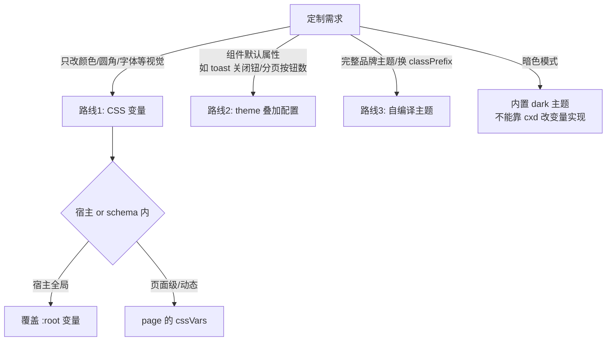

# amis 自定义主题

官方四种定制方式（docs/zh-CN/style/index.md）：CSS 变量、辅助 class（helper.css）、自编译主题 css、wrapper 内嵌 style。**先按需求选路线，不要一上来就复制整套 scss**：



## 路线 1：CSS 变量（首选，覆盖 80% 定制需求）

```json
// schema 内（page 属性，运行时生成 :root 覆盖，不支持 IE11）
{
  "type": "page",
  "cssVars": {
    "--primary": "#CD3632",
    "--primary-onHover": "#F23F3A",
    "--primary-onActive": "#BB312D",
    "--text-color": "#CD3632",
    "--body-bg": "#fafafa"
  }
}
```

宿主侧全局定制直接写 CSS：`:root { --primary: #xxx; }`（动态换肤参考 examples/components/Theme.tsx：把变量写入 `<style>` 标签实时预览）。

- 常用变量：`--primary(-onHover/-onActive)/--success/--info/--warning/--danger/--text-color/--body-bg/--borderColor/--borderRadius/--background`，完整清单 docs/zh-CN/style/css-vars.md。
- 变量三层体系（token → 语义 → 组件）与 cssVars 的安全过滤实现见 **references/scss-and-css-vars.md**。

## 路线 2：theme() 叠加配置（只改行为，不动样式）

在现有主题上叠加组件默认 props，无需换 css：

```ts
import {theme} from 'amis-core';  // 或 'amis'

theme('cxd', {                       // 也可以注册成新名字 'mytheme'
  classPrefix: 'cxd-',               // 继续用 cxd 的 css
  renderers: {                       // 按渲染器 type 给默认 props
    pagination: {maxButtons: 9, showPageInput: false},
    'tabs-control': {mode: 'line'}
  },
  components: {                      // 按 themeKey 给 amis-ui 组件默认 props
    toast: {closeButton: true}
  }
});
// 用法1：全局默认 setDefaultTheme('mytheme')
// 用法2：amis.render(schema, props, {theme: 'mytheme'})
```

## 路线 3：完整自定义主题（classPrefix + 自编译 css）

官方原文："目前只能通过源码方式……修改变量后重新编译一个 css"，**升级 amis 时需重编译，官方不推荐**。能被路线 1/2 满足就别走这条。

JS 侧（amis-core/src/theme.tsx 的真实 API，**不存在 makeTheme/ThemeProvider/setTheme**）：

```ts
import {theme, makeClassnames, setDefaultTheme} from 'amis-core';

theme('mytheme', {
  classPrefix: 'my-',               // cx('Button') → .my-Button
  classnames: makeClassnames('my-'),
  renderers: {/* 同路线 2 */},
  components: {/* 同路线 2 */}
});
```

SCSS 侧（复制 amis-ui 主题文件模式）：

```scss
// packages/amis-ui/scss/themes/my-theme.scss（参考 cxd.scss 四行结构）
@import '../properties';
@import '../components';
@import './my-variables';   // 内容：$ns: 'my-'; + :root { --colors-brand-5: ...; 全套 token }
@import './common';
```

编译得到 `my-theme.css`（amis-ui rollup 会对 scss/themes/*.scss 逐个出 lib/themes/*.css），宿主引入该 css + `env.theme = 'mytheme'`。

完整步骤与变量命名规则见 **references/scss-and-css-vars.md**。

## 运行时切换主题

主题由 **env（`amis.render/embed` 第三/四个参数）的 `theme` 字段**控制，schema 节点没有 theme 属性。优先级：`props.theme > options.theme > defaultTheme('cxd')`，'default' 归一为 cxd。

```ts
// 1. 引入目标主题的 JS 注册（内置主题：import 'amis/lib/themes/antd'，源码 import 'amis-ui/lib/themes/antd'）
// 2. 换 css 引用：<link href=".../lib/themes/antd.css"> 或 import 'amis/lib/themes/antd.css'
// 3. 渲染时指定：amis.embed('#root', schema, {}, {theme: 'antd'})
// 4. 弹层类组件需要手动传主题（examples/embed.tsx:285-296）：
<ToastComponent theme={env.theme} />
<AlertComponent theme={env.theme} />
```

没有运行时全局 setTheme API：切主题 = 重调 render 换 env.theme + 换 css link。

## dark 暗色

独立主题（`dark.ts`：classPrefix `'dark-'` + jsonTheme/editorTheme 等 renderer 配置；`dark.css` 独立编译，中性色板整体反转）。**在 cxd 上改 `:root` 变量做不出 dark**——dark 的组件类名前缀都不同。用法同"运行时切换"传 `theme: 'dark'`。

## 排查"主题不生效"

1. css 引用与 env.theme 是否配套（引了 cxd.css 却传 theme: 'antd' → 类名前缀对不上）
2. Toast/Alert 弹层组件是否漏传 theme（它们独立于渲染树，要单独传）
3. 覆盖的变量名是否存在（查 docs/zh-CN/style/css-vars.md 或 _properties.scss）
4. cssVars 的 key 必须以 `--` 开头、值含 `expression(` 或 `;` 会被过滤（防 XSS，Page.tsx:385-411）

## 深入阅读（references/）

- **references/theme-architecture.md**：theme.tsx 全 API、ThemeConfig、themeable/themeKey 注入机制、Root 渲染链路、内置四主题源码、常见误区
- **references/scss-and-css-vars.md**：scss 目录全景、三层变量体系、主题文件模板、构建产物链、cssVars 运行时实现、开发规约

## 完成检查清单

- [ ] 路线选择正确（优先 CSS 变量 > theme 叠加 > 自编译）
- [ ] css 引用与 env.theme 的主题名一致
- [ ] ToastComponent/AlertComponent 已传 theme
- [ ] 新增 CSS 变量已进 _properties.scss/_components.scss（若改源码）
- [ ] 换肤后暗色/弹层/编辑器预览三处都验证过
