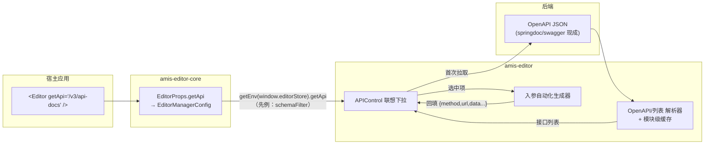

# amis 编辑器 API 配置智能化：全局 getApi 接口选择与 OpenAPI 入参自动化

> 状态：设计中（已与需求方确认核心决策）
> 日期：2026-11-02
> 分支：feat-editor-api-select

## 1. 背景与需求

### 1.1 问题

amis 编辑器中所有 API 配置（通用 API、Service、CRUD、Form 的 initApi/source 等）都是**纯手动输入**请求地址。使用低代码框架的用户（宿主）后端已有完整的接口定义，编辑时却要人工复制粘贴 url、手写参数，存在：

- 接口地址写错无从校验
- 入参结构（query/body 字段）靠记忆或翻文档
- 接口元信息（method、必填参数、枚举值）无法在编辑时呈现

### 1.2 需求

宿主在 amis 编辑器全局配置中指定一个获取所有 API 的 GET 请求（`getApi`）：

- 配置了 `getApi`：编辑器从该接口拉取接口定义（含 method、url、入参），在 API 配置处供用户**联想下拉选择**（支持按接口名称/路径模糊匹配），选中后**自动回填真实 API 对象并自动化生成请求参数配置**
- 未配置 `getApi`：保持原有手动输入方式，**行为零变化**
- 始终兼容手动输入请求地址（不强制选择）

### 1.3 已确认的核心决策

| 决策点 | 结论 | 理由 |
|---|---|---|
| 选中后值存储形式 | **回填真实 API 对象**（非 `api://key` 引用） | 后端只需一个接口定义源；页面运行时零改动；schema 可移植。引用模式需要运行时 schemaFilter/fetcher 翻译，schema 离开宿主环境失效 |
| 交互形式 | **输入框联想下拉**（非独立选择面板） | 与"兼容原有输入方式"天然融合：同一个框，有匹配则下拉，无匹配即手输 |
| 数据源协议 | **优先兼容 OpenAPI 标准**（3.0 + Swagger 2.0），自动探测；同时保留自定义 items 简单列表 | 后端零开发（springdoc/swagger 现成暴露 `/v3/api-docs`）；入参类型/枚举/必填信息完整；自定义列表作为轻量兜底 |
| 入参自动化形态（第一期） | **直接回填占位模板**（`{data: {id: '${id}'}}`） | 页面数据域有同名变量直接生效；参数绑定面板列为后续增强 |
| 覆盖范围 | `ae-apiControl` 一处改造，覆盖全部 `getSchemaTpl('apiControl')` 使用点（含 Service） | 统一入口，改动集中；事件动作面板的 ActionApiControl 为独立实现，二期扩展 |

## 2. 总体设计



配置读取链路复用现有机制：`EditorProps` 上的新增字段随 `EditorManagerConfig` 下发，渲染器控件通过 `getEnv((window as any).editorStore)` 读取（[APIControl.tsx](../packages/amis-editor/src/renderer/APIControl.tsx) 中已有读取 `schemaFilter` 的相同先例）。

## 3. 详细设计

### 3.1 全局配置接口

```tsx
// 宿主接入（仅编辑器侧，页面运行时零改动）
<Editor
  getApi="/v3/api-docs"            // 字符串
  // 或完整 SchemaApi 对象
  getApi={{url: '/api/list', method: 'get', data: {group: 'user'}}}
  ...
/>
```

- 类型：`SchemaApi`（amis 标准 API 定义，默认 method 为 get）
- 未配置 / 值为空：APIControl 走现有代码路径，完全不变

### 3.2 数据源解析与格式探测

拉取响应后自动探测格式，宿主无需声明。

**探测输入契约**：不同宿主的 `env.fetcher` 解包行为不同（仓库默认 fetcher 直接返回 axios response，裸 OpenAPI 文档落在 `res.data`；按 amis 协议解包的宿主 fetcher 则文档落在 `res.data.data`）。因此探测函数对 `res.data` 与 `res.data.data` **两层都检查**，任一层命中即采用：

| 探测条件（两层任一命中） | 解析器 | 接口项来源 |
|---|---|---|
| 含 `openapi` 字段（3.x） | OpenAPI 3.0 解析器 | 遍历 `paths`，每个 path × method 为一项 |
| 含 `swagger` 字段（2.0） | Swagger 2.0 解析器 | 同上；`definitions` / `in: body` 参数差异兼容 |
| 含 `items` 数组 | 简单列表解析器 | `items: [{name, method, url, ...api定义}]`，`...` 中的 `data`/`headers` 等字段选中时透传 |

**响应非法**定义：两层均未命中任何已知结构（无 `openapi`/`swagger`/`items`），视为拉取失败，走 3.3 降级路径。

**统一内部模型**（解析器输出）：

```ts
interface ApiItem {
  name: string;            // 显示名与匹配字段：OpenAPI 的 summary > operationId > path
  method: string;          // get/post/...
  path: string;            // 原始路径（可能含 {id} 占位）
  tags?: string[];         // OpenAPI 分组
  queryParams?: ApiParam[];    // in: query
  pathParams?: ApiParam[];     // in: path
  bodySchema?: ApiParam[];     // requestBody / in:body schema 拍平的属性列表
}

interface ApiParam {
  name: string;
  type?: string;           // string/integer/boolean...
  required?: boolean;
  enum?: Array<string | number>;
  description?: string;
}
```

**OpenAPI 解析规则**：

- `requestBody.content['application/json'].schema` 支持 `$ref: '#/components/schemas/Xxx'` 递归解析（2.0 为 `definitions`），带环引用防护（已解析路径集合，环处截断）
- 嵌套对象属性递归拍平为 `a.b` 形式或保留结构（见 3.4 回填规则，生成 data 映射时保留嵌套结构）
- `enum`、`required`、`description` 保留为元信息，联想下拉与提示中展示

### 3.3 APIControl 联想下拉交互

**触发条件**：`getEnv(editorStore).getApi` 存在且接口列表拉取成功。

**行为**：

1. 控件首次进入联想模式时拉取接口列表，解析为 `ApiItem[]` 存**模块级缓存**（编辑器内 APIControl 实例极多——每个组件面板一个，必须全局共享一次请求；相同 getApi 配置不重复拉取）
2. 输入框聚焦/输入 → 前端本地模糊匹配（`name` 与 `path`，忽略大小写，includes 匹配）→ 下拉列表展示：`名称 + method 徽标 + path`，有 `tags` 时分组
3. 选中某项 → 调用入参自动化生成器（3.4）产出 api 定义 → `onChange` 回填；输入框展示沿用 `transformApi2Str` 规则（如 `POST:/api/user/create`）
4. 选中后仍可通过现有"高级设置"弹窗微调（headers、adaptor、data 等），完全兼容
5. 输入内容无匹配 → 即普通手输，走现有 `handleSimpleInputChange` 逻辑，**不强制选择、不拦截**

**未配置 getApi / 拉取失败**：

- 未配置：代码路径不变，无任何视觉差异
- 拉取失败或响应非法（见 3.2 定义）：**失败结果同样写入模块级缓存（负缓存）**，编辑器会话内不再自动重试（避免多实例反复请求）；toast 提示"接口列表获取失败"**全局去重只弹一次**；控件降级为普通手输，不阻塞配置；高级设置弹窗不受影响

### 3.4 入参自动化生成规则

选中 `ApiItem` 后生成回填的 api 对象：

**url 前缀拼接规则**：OpenAPI 3 取 `servers[0].url`、Swagger 2 取 `basePath` 作为前缀（缺省为空串），拼接在 path 之前。前缀为相对路径（如 `/api`）直接拼接；为绝对 URL（`http://…`）时拼接完整 URL，回填后用户可在输入框/高级设置中自行改写。示例：`basePath: '/api'` + path `/user/{id}` → `/api/user/${id}`。

| OpenAPI 定义 | 生成规则 | 示例 |
|---|---|---|
| path 参数（`/user/{id}`） | url 占位符替换 | `url: '/api/user/${id}'`（`/api` 来自 basePath/servers 拼接） |
| query 参数 | `data` 映射（amis 的 GET 请求自动将 data 序列化为 query） | `data: {pageNum: '${pageNum}'}` |
| requestBody 属性 | `data` 映射，嵌套对象保留结构 | `data: {name: '${name}', role: '${role}'}` |
| 简单列表项的 `data`/`headers` 等字段 | 原样透传 | — |

- 占位符统一为 `${参数名}`：与页面数据域同名变量直接生效；无同名变量时值为 undefined，用户后续自行绑定（第一期不做参数绑定面板）
- 生成结果与现有 value 合并沿用 `handleSubmit` 的 `mergeWith` 逻辑：`adaptor`/`sendOn` 等普通字段保留用户已配置值；`data`/`responseData`/`headers` 按 existing customizer 为**整体替换**（换接口场景下旧接口的请求体/请求头不应残留，属预期行为）

### 3.5 改动文件清单

| 文件 | 改动 |
|---|---|
| `packages/amis-editor-core/src/component/Editor.tsx` | `EditorProps` 新增 `getApi?: SchemaApi` |
| `packages/amis-editor/src/renderer/APIControl.tsx` | 联想下拉 UI 与交互、缓存、选中回填 |
| `packages/amis-editor/src/renderer/apiPicker/`（新增） | 数据源拉取与缓存、格式探测、OpenAPI 3.0/2.0 解析器、简单列表解析器、入参自动化生成器（纯函数，独立可测） |
| `packages/amis-editor/src/locale/zh-CN.ts`、`en-US.ts` | 失败提示等文案（按仓库约定用 `npm run i18n:update` 同步维护） |
| `docs/zh-CN/extend/editor.md` | getApi 配置说明 |

## 4. 兼容性

- **未配置 getApi 的宿主**：所有代码路径不变，视觉与行为零差异（通过开关分支保证）
- **已配置宿主**：手动输入始终可用；高级设置弹窗不变；回填值为标准 Api 对象，不引入 `api://` 等新协议，**页面运行时零改动**
- 现有爱素搭 Picker 模式（`enablePickerMode`/`pickerSource`）不受影响，两套机制互不干扰（enablePickerMode 优先级高于 getApi 联想）

## 5. 测试计划

解析器为纯函数，重点单测（`packages/amis-editor/src/__tests__` 或 renderer 同级，`*.test.ts` 命名）：

> **测试前置说明**：amis-editor 包自身无 jest 配置（test script 为占位），根 jest 的 `testRegex` 可直接拾取本包测试文件。纯解析器/生成器测试仅依赖 ts，无障碍；**控件层（UI）测试**会 import `amis-editor-core`，根 jest 的 moduleNameMapper 未映射该包（会解析到构建产物），需先 `npm run build` 或在根 jest 配置补 mapper 条目——计划中作为前置任务处理。

1. **格式探测**：OpenAPI 3.0 / Swagger 2.0 / 简单 items 三种响应正确路由；两层探测（裸文档在 `res.data` 与解包后在 `res.data.data`）均命中；两层均无已知结构判为非法
2. **OpenAPI 解析**：paths 展开、summary/operationId 兜底命名、tags 分组、$ref 递归、环引用不栈溢出、enum/required 提取、servers/basePath 前缀提取
3. **入参生成**：path 占位替换、url 前缀拼接（相对前缀/绝对 URL/缺省）、query→data、body 属性→data（嵌套结构保留）、简单列表字段透传
4. **联想交互**：模糊匹配（名称/路径/大小写）、选中回填值形态、与已有 value 的合并（adaptor 保留、data/headers 整替换）
5. **缓存**：多个 APIControl 实例共享一次请求；失败负缓存（会话内不重试）；toast 全局一次
6. **降级**：getApi 失败后手输不受影响
7. **回归**：未配置 getApi 时现有用例/快照全绿

## 6. 分期

| 期 | 内容 |
|---|---|
| 第一期（本设计） | getApi 全局配置 + OpenAPI(3.0/2.0)/简单列表解析 + 联想下拉 + 占位模板回填 |
| 二期（候选） | ActionApiControl（事件动作面板）覆盖；选中后参数绑定面板（变量选择器逐参数绑定）；responses 结构驱动的返回数据映射提示 |
